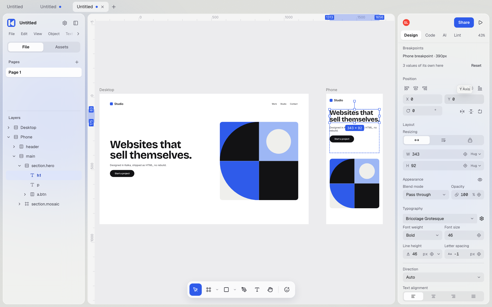

# Kalka

[](LICENSE)

Kalka is an open source design tool, an alternative to Figma, where every layer is real HTML and CSS. What you draw is already a web page: no export step, no rebuild in code.

> **Status:** Beta. Tester builds for macOS, Windows and Linux are on the [Releases](https://github.com/leyscore/kalka/releases) page; macOS is the most tested. Follow the build on [kalka.design](https://kalka.design) and on X, [@bedleybuilds](https://x.com/bedleybuilds).



## What it does

- **The canvas is the browser.** Every layer is an element the browser lays out and paints, so flexbox, grid, fonts, shadows and blurs look on the canvas exactly as they will in production.
- **The layers panel is the DOM.** A layer can be an `h1`, `nav`, `a` or `button` and carry class names; classes hold shared styles, and changing one restyles every layer that has it.
- **Breakpoints.** Give an artboard a tablet or phone breakpoint that shares its layers; what you change there is exported as `@media` rules.
- **Your agent drafts, you finish by hand.** Kalka ships its own MCP server: Claude Code, Codex, Cursor or any MCP client writes HTML onto the canvas as editable layers, reads it back, and checks its work with screenshots.
- **Files you own.** A Kalka document is a folder: one HTML page per page, `styles.css`, design tokens and assets. Open it in a code editor, and keep its versions with Git from the Versions tab.
- **CSS as written.** A layer keeps the CSS you, an import or an agent gave it, such as `width: 50%` or `padding: 1rem`, while the panel edits what it can show; the CSS a layer keeps survives `.fig` round trips.
- **Bring existing work.** Open Figma `.fig` and Pencil `.pen` files, paste HTML from a web page or a code editor, or open a file from a URL.
- **Familiar tools.** Components and variants, variables, auto layout, live shaders, icon search, real-time collaboration, and a built-in AI chat with your own API key.
- **Export.** Standalone HTML, Tailwind JSX, Storybook stories, PNG, JPG, SVG and PDF, drawn by the same browser engine as the canvas, from the app or the `kalka` command line.

## Install

Download the latest build from [Releases](https://github.com/leyscore/kalka/releases): the `.dmg` on macOS, the `.exe` installer on Windows, the `.AppImage` on Linux. The app updates itself from the same page.

Beta builds are not signed yet, so the system warns before the first launch:

- **macOS:** right-click Kalka in Applications and choose **Open**, then **Open** again. If macOS says the app is damaged, run `xattr -dr com.apple.quarantine /Applications/Kalka.app` in Terminal.
- **Windows:** in the SmartScreen window, choose **More info**, then **Run anyway**.
- **Linux:** make the file executable (`chmod +x Kalka-*.AppImage`) and run it.

Open the sample document on the home screen to start from Kalka's own landing page. To build the app from source instead:

```sh
bun install
bun run package:desktop   # DMG and ZIP on macOS, installer on Windows, AppImage on Linux
```

## Connect an agent

The desktop app includes its MCP server and starts it itself. Open **Settings → MCP** to connect Claude Desktop, Claude Code, Cursor, VS Code, Windsurf, Codex, Gemini CLI, Antigravity, Kiro, Zed, LM Studio or opencode in one click, or copy the configuration for any other client.

Agents start with `get_selection` or `get_page_tree`, build with `write_html`, adjust with `update_styles`, and check with `get_screenshot`. The server also asks them to bring in what the design depends on, such as specs, docs or real data, from the other servers the client has connected.

## Develop

```sh
bun install
bun run dev           # Web editor at http://localhost:1420
bun run dev:desktop   # Desktop app (Electron) with hot reload
bun run check         # Build, lint, types, architecture and docs checks
bun run test:unit     # Engine and unit tests
```

[CONTRIBUTING.md](CONTRIBUTING.md) covers setup, quality gates, pull requests and commits. [AGENTS.md](AGENTS.md) maps the repository and links the guide inside each package. The command line runs from a checkout with `bun kalka --help`.

### Tech stack

| Layer         | Tech                                                         |
| ------------- | ------------------------------------------------------------ |
| Canvas        | Browser DOM and CSS; CanvasKit (Skia WASM) for raster export |
| UI            | Vue 3, Reka UI, Tailwind CSS 4                               |
| File formats  | Kalka folder (HTML, CSS, JSON), `.fig` (Kiwi + Zstd + ZIP)   |
| Collaboration | Trystero (WebRTC P2P) + Yjs (CRDT)                           |
| Desktop       | Electron                                                     |
| AI and MCP    | Vercel AI SDK (bring your own key), MCP SDK, Hono            |

## Credits

Kalka is a fork of [OpenPencil](https://github.com/open-pencil/open-pencil) by Danila Poyarkov and its contributors, whose editor, `.fig` support, tools and MCP server it builds on.

## License

Kalka's desktop app and local MCP server are licensed under the [MIT License](./LICENSE).
