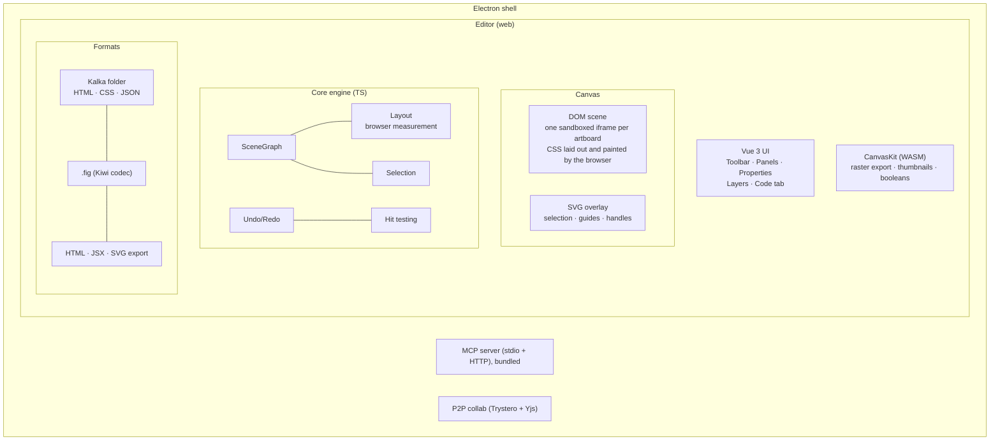

# Architecture

## System Overview

For source identity, override evaluation, page sessions, and export contracts, see
[.fig Reader Architecture](./fig-reader).

## Editor Layout

The UI follows Figma's UI3 layout: toolbar at the bottom, navigation on the left, properties on the right.

- **Navigation panel (left)**: pages, the layers tree (which is the artboard's DOM), assets and versions
- **Canvas (center)**: infinite canvas of artboards drawn as real web pages, with zoom and pan
- **Properties panel (right)**: Design, Code, AI and Lint tabs; the Design tab adds HTML (tag and classes) and Breakpoints sections to Figma's
- **Toolbar (bottom)**: Select, Frame, Section, Rectangle, Ellipse, Line, Text, Pen, Hand

## Components

### Canvas (DOM scene)

Every top-level layer (an artboard) is drawn as its own page in a sandboxed iframe (`allow-same-origin`, no scripts, a CSP that keeps it off the network). `DomSceneProjector` in `packages/vue/src/canvas/dom-scene/` projects layers to HTML and CSS through `@kalka/dom-css`, patches the DOM when the graph changes, and the browser lays out and paints the result. Text is edited in place with ProseMirror.

Selection, hover, guides, handles and other editor feedback are drawn by an SVG overlay above the iframes (`packages/vue/src/canvas/svg-overlay/`).

Only artboards on screen or about to be have a live iframe. The projector holds each at a tier from where it lies against the view (`tiers.ts`), with margins that keep one on a boundary from flapping during a pan:

| Tier | When | Drawn by |
|---|---|---|
| visible | on screen | a live iframe that paints |
| pictured | on screen, the view zoomed out to 25 % or less, where a snapshot of a mebibyte at most shows every pixel it draws | a snapshot; the artboard holding the selection or an edit stays visible |
| near | within a screen of it | a live iframe that does not paint, so it shows at once |
| far | within three screens | a snapshot taken at the zoom, up to a mebibyte each and 32 MiB together; the iframe and its document are freed |
| dormant | farther, or never approached | a placeholder of its fill |

Iframes wake and go to sleep once the view rests, a few a frame; snapshots are taken while the canvas idles, by drawing the artboard's projection as an SVG `foreignObject` image with its fonts embedded, which costs a few milliseconds on a recent Mac. While an iframe loads, the stand-in stays until its document is built with its fonts. Layout of an artboard without a live document goes to the offscreen engine: an edit lays it out at once, and one never laid out since the page opened is laid out while the canvas idles. A feature that reads or edits an artboard's DOM wakes it with `retain`, `whenLive` or `withLiveArtboard`; the text editor does, and `get_computed_styles` through `drawLayerWithEngines`. Exports, thumbnails, hit testing, the overlay and agent previews read the graph, not the iframes.

### Layout

The browser is the only layout engine; Core computes no layout itself. `computeLayout` and `computeAllLayouts` from `@kalka/core/layout` hand a layer to the engines installed with `installLayoutEngine`, latest first: an engine that does not draw the layer leaves it to the one installed before. Each engine projects artboards to the HTML and CSS the canvas builds (`artboardMarkup` from `@kalka/dom-css/export`), lets a browser lay them out, and writes every box back into the layers' `x`, `y`, `width` and `height` with the canvas's own `measureLayerBoxes` and `applyMeasuredLayout`; the fields become a cache of what the browser computed. Without an engine that draws a layer, nothing is laid out again and layers keep the geometry they have.

| Where | Engine | Browser |
|---|---|---|
| App, current page | `DomLayoutEngine` (`packages/vue/src/canvas/dom-scene/layout.ts`) | the canvas's own artboard iframes |
| App, everything else: other pages, export copies, previews, artboards that sleep or whose iframe is loading | `BrowserLayoutEngine` with `createDocumentLayout` (`src/app/editor/layout/offscreen.ts`) | hidden blank iframes of the editor's page, written and measured synchronously |
| CLI, `@kalka/cli/layout` | `BrowserLayoutEngine` with `scriptLayoutPage` (`packages/cli/src/render/layout.ts`) | the render host, an Electron process with no window (`electron/src/render-host.ts`) |
| Unit tests | the same, through one host per test process (`tests/helpers/layout/browser.ts`) | the render host |

`BrowserLayoutEngine` (`packages/core/src/layout/browser.ts`) lays out whole artboards, hidden ones as if shown, sends them in batches and lays one out again only once an edit or a preview touched it. For the CLI, layout is synchronous and the host is another process, so the main thread blocks on a worker thread that talks to the host (`packages/cli/src/render/host/session.ts`). The MCP stdio bridge computes no layout: it relays tool calls to the app.

#### Without a browser

The CLI installed from npm has no browser: Electron is about 300 MB unpacked and Playwright's Chromium about 340 MB (190 MB for its headless shell), against a CLI of a few megabytes, so neither is a dependency. Commands that lay out (`export`, `eval`, `convert`, `lint`, `tool`) call `useBrowserLayout()`, which uses the render host when the desktop app is built beside the CLI and otherwise says once, on stderr, that layers keep their saved layout. A document then keeps the geometry its file stores, which for a `.fig` is Figma's own layout; edits that move layers inside auto layout are not reflowed until the document is opened where a browser lays it out. `KALKA_LAYOUT=stored` asks for this behaviour with the host present. The read-only commands (`tree`, `node`, `query`, `info`) never start the host and read the stored geometry.

#### Cost

Measured on an Apple M-series laptop: the host starts with the first layout in about 230 ms; a layout request for a small artboard then takes 0.2 ms at the median (0.4 ms at the 95th percentile), and an artboard of 421 layers 5 ms. The quick unit suite (`bun tools/dev/unit-tests/src/run.ts all`), one process and so one host, took 84 s with Yoga and takes 85 s with the browser; the CLI's group, which starts the CLI in processes of its own, is most of either. On Linux CI every unit shard installs Electron and runs under `xvfb-run`. With `--isolate`, each test file gets a host of its own, closed with it.

#### What the browser does not do as Figma does

Yoga also carried heuristics that kept geometry a `.fig` saved where its own layout disagreed; the browser lays the page out as the canvas draws it instead. Text is measured with the fonts the browser has, so an imported label can differ from Figma's box by up to a few pixels, and text the browser sizes differently is shaped again when the file is saved. Boxes come back in sixty-fourths of a pixel. A fixed-size text box stretched across a hugging parent does not count towards the hug, a hugging child of a grid stretches across its cell, empty text has no height, and padding larger than a fixed box grows it. Tests that record Figma's behaviour for these are marked `test.failing` until the projected CSS matches it.

### CanvasKit

CanvasKit (Skia WASM) no longer draws the canvas. It renders raster exports where the browser cannot, thumbnails, boolean geometry and vector conversion. On desktop, PNG and JPG exports and the thumbnail saved in `.fig` files are captured from the browser instead (`render_html_image`), and PDF exports printed by it (`render_html_pdf`), so they match the canvas.

### HTML model

Layers carry what the exported page needs: an HTML tag and class names (`htmlTag`, `htmlClasses`), document classes holding shared styles (`cssClasses` on the root), and breakpoint artboards that share their primary's layers (`responsiveSource`), exported as `@media` rules. The projection, the class model and the breakpoint cascade live in `@kalka/scene-graph` and `@kalka/dom-css`.

### Scene Graph

Flat `Map<string, Node>` keyed by GUID strings. Tree structure via `parentIndex` references. Provides O(1) lookup, efficient traversal, hit testing, and rectangular area queries for marquee selection.

The graph emits typed events via nanoevents: `node:created`, `node:updated`, `node:deleted`, `node:reparented`, `node:reordered`. Subsystems subscribe to these instead of manual call-site wiring — the editor uses them for render invalidation and microtask-batched component instance sync, while the collab system uses them for Yjs propagation.

See [Scene Graph Reference](/reference/scene-graph) for internals.

### File formats

A Kalka document is saved as a folder: one HTML page per page with inline CSS and `data-kalka-*` editor attributes, `styles.css` for classes, design tokens and assets. See [File Format Reference](/reference/file-format).

`.fig` files reuse Figma's Kiwi binary codec with 194 message/enum/struct definitions. Import: parse header → Zstd decompress → Kiwi decode → `NodeChange`[] → scene graph. Export reverses the process with thumbnail generation.

### AI & Tools

Tools are defined once in `packages/core/src/tools/`, split by domain: read, create, modify, structure, variables, vector, analyze. Each tool has typed params and an `execute(figma, args)` function. Adapters convert them for:

- **AI chat** — valibot schemas, multi-provider (Anthropic, OpenAI, Google AI, OpenRouter, compatible endpoints)
- **MCP server** — zod schemas, stdio + HTTP transports
- **CLI** — available via the `eval` command, whose scripts get the `figma` Plugin API and the `kalka` API

The HTML tools are how agents work in Kalka: `write_html` adds HTML and CSS as editable layers, `get_html` and `get_computed_styles` read them back, `update_styles`, `set_html_element`, `update_css_class` and `add_breakpoint` change them, and `get_screenshot` lets the agent check its work. The MCP server ships inside the desktop app and states these instructions to every client (`packages/mcp/src/server/identity.ts`).

Beyond them, the tools include XPath query (`query_nodes`), JSX inspection (`get_jsx`, `diff_jsx`), semantic description (`describe`), and vision-based verification (`export_image` returns images to the model).

### Behaviours and Preview

A behaviour stored on a main component makes it work as a Reka UI control. Preview runs top-level layers holding controls as live islands: shadow-DOM projections laid over the canvas, with each control mounted as its Reka UI primitive and drawn by the component's variants. See [Behaviours and Preview](./behaviours-and-preview).

### Undo/Redo

Inverse-command pattern. Before applying any change, affected fields are snapshotted. The snapshot becomes the inverse operation. Batching groups rapid changes (like drag) into single undo entries.

### Clipboard

Figma-compatible bidirectional clipboard. Encodes/decodes Kiwi binary (same format as .fig files) via native browser copy/paste events. Handles vector path scaling, instance children, component set detection, and override application.

### P2P Collaboration

Real-time peer-to-peer collaboration via Trystero (WebRTC) + Yjs CRDT. No server relay — signaling over MQTT public brokers, STUN/TURN for NAT traversal. Awareness protocol provides live cursors, selections, and presence. Local persistence via y-indexeddb.

### CLI-to-App RPC Bridge

When the desktop app is running, CLI commands connect to it via WebSocket instead of requiring a .fig file. The automation server runs on `127.0.0.1:7600` (HTTP) and `127.0.0.1:7601` (WebSocket). Commands execute against the live editor state, enabling automation scripts and AI agents to interact with the running app.

## What's Next

Product direction and the remaining Figma compatibility gaps are tracked in the [roadmap](./roadmap).
