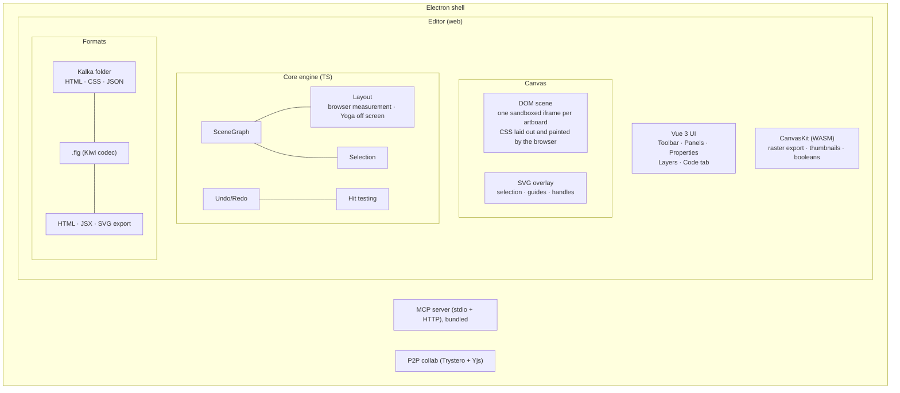

# Architecture

## System Overview

For source identity, override evaluation, page sessions, and export contracts, see
[.fig Reader Architecture](./fig-reader).

## Editor Layout

The UI follows Figma's UI3 layout: toolbar at the bottom, navigation on the left, properties on the right.

- **Navigation panel (left)**: pages, the layers tree (which is the artboard's DOM), assets and versions
- **Canvas (center)**: infinite canvas of artboards drawn as real web pages, with zoom and pan
- **Properties panel (right)**: Design, Code, AI and Lint tabs; the Design tab adds HTML (tag and classes) and Breakpoints sections to Figma's
- **Toolbar (bottom)**: Select, Frame, Section, Rectangle, Ellipse, Line, Text, Pen, Hand

## Components

### Canvas (DOM scene)

Every top-level layer (an artboard) is drawn as its own page in a sandboxed iframe (`allow-same-origin`, no scripts, a CSP that keeps it off the network). `DomSceneProjector` in `packages/vue/src/canvas/dom-scene/` projects layers to HTML and CSS through `@kalka/dom-css`, patches the DOM when the graph changes, and the browser lays out and paints the result. Text is edited in place with ProseMirror.

Selection, hover, guides, handles and other editor feedback are drawn by an SVG overlay above the iframes (`packages/vue/src/canvas/svg-overlay/`).

### Layout

The browser is the layout engine. `DomLayoutEngine` (installed through `installLayoutEngine` from `@kalka/core/layout`) measures each box after the DOM is written and stores it back into the layers' `x`, `y`, `width` and `height`, which become a cache of what the browser computed. Graphs the canvas does not draw, such as other pages, headless CLI runs and export previews, still use Yoga WASM.

### CanvasKit

CanvasKit (Skia WASM) no longer draws the canvas. It renders raster exports where the browser cannot, thumbnails, boolean geometry and vector conversion. On desktop, PNG and JPG exports and the thumbnail saved in `.fig` files are captured from the browser instead (`render_html_image`), and PDF exports printed by it (`render_html_pdf`), so they match the canvas.

### HTML model

Layers carry what the exported page needs: an HTML tag and class names (`htmlTag`, `htmlClasses`), document classes holding shared styles (`cssClasses` on the root), and breakpoint artboards that share their primary's layers (`responsiveSource`), exported as `@media` rules. The projection, the class model and the breakpoint cascade live in `@kalka/scene-graph` and `@kalka/dom-css`.

### Scene Graph

Flat `Map<string, Node>` keyed by GUID strings. Tree structure via `parentIndex` references. Provides O(1) lookup, efficient traversal, hit testing, and rectangular area queries for marquee selection.

The graph emits typed events via nanoevents: `node:created`, `node:updated`, `node:deleted`, `node:reparented`, `node:reordered`. Subsystems subscribe to these instead of manual call-site wiring — the editor uses them for render invalidation and microtask-batched component instance sync, while the collab system uses them for Yjs propagation.

See [Scene Graph Reference](/reference/scene-graph) for internals.

### Off-screen layout (Yoga WASM)

Where the browser does not lay a graph out, Meta's Yoga computes flexbox and grid through a [fork](https://github.com/open-pencil/yoga/tree/grid) with CSS Grid support. A thin adapter maps Figma property names to Yoga equivalents:

| Figma Property | Yoga Equivalent |
|---|---|
| `stackMode: HORIZONTAL` | `flexDirection: row` |
| `stackMode: VERTICAL` | `flexDirection: column` |
| `stackSpacing` | `gap` |
| `stackPadding` | `padding` |
| `stackJustify` | `justifyContent` |
| `stackChildPrimaryGrow` | `flexGrow` |

### File formats

A Kalka document is saved as a folder: one HTML page per page with inline CSS and `data-kalka-*` editor attributes, `styles.css` for classes, design tokens and assets. See [File Format Reference](/reference/file-format).

`.fig` files reuse Figma's Kiwi binary codec with 194 message/enum/struct definitions. Import: parse header → Zstd decompress → Kiwi decode → `NodeChange`[] → scene graph. Export reverses the process with thumbnail generation.

### AI & Tools

Tools are defined once in `packages/core/src/tools/`, split by domain: read, create, modify, structure, variables, vector, analyze. Each tool has typed params and an `execute(figma, args)` function. Adapters convert them for:

- **AI chat** — valibot schemas, multi-provider (Anthropic, OpenAI, Google AI, OpenRouter, compatible endpoints)
- **MCP server** — zod schemas, stdio + HTTP transports
- **CLI** — available via the `eval` command, whose scripts get the `figma` Plugin API and the `kalka` API

The HTML tools are how agents work in Kalka: `write_html` adds HTML and CSS as editable layers, `get_html` and `get_computed_styles` read them back, `update_styles`, `set_html_element`, `update_css_class` and `add_breakpoint` change them, and `get_screenshot` lets the agent check its work. The MCP server ships inside the desktop app and states these instructions to every client (`packages/mcp/src/server/identity.ts`).

Beyond them, the tools include XPath query (`query_nodes`), JSX inspection (`get_jsx`, `diff_jsx`), semantic description (`describe`), and vision-based verification (`export_image` returns images to the model).

### Behaviours and Preview

A behaviour stored on a main component makes it work as a Reka UI control. Preview runs top-level layers holding controls as live islands: shadow-DOM projections laid over the canvas, with each control mounted as its Reka UI primitive and drawn by the component's variants. See [Behaviours and Preview](./behaviours-and-preview).

### Undo/Redo

Inverse-command pattern. Before applying any change, affected fields are snapshotted. The snapshot becomes the inverse operation. Batching groups rapid changes (like drag) into single undo entries.

### Clipboard

Figma-compatible bidirectional clipboard. Encodes/decodes Kiwi binary (same format as .fig files) via native browser copy/paste events. Handles vector path scaling, instance children, component set detection, and override application.

### P2P Collaboration

Real-time peer-to-peer collaboration via Trystero (WebRTC) + Yjs CRDT. No server relay — signaling over MQTT public brokers, STUN/TURN for NAT traversal. Awareness protocol provides live cursors, selections, and presence. Local persistence via y-indexeddb.

### CLI-to-App RPC Bridge

When the desktop app is running, CLI commands connect to it via WebSocket instead of requiring a .fig file. The automation server runs on `127.0.0.1:7600` (HTTP) and `127.0.0.1:7601` (WebSocket). Commands execute against the live editor state, enabling automation scripts and AI agents to interact with the running app.

## What's Next

Product direction and the remaining Figma compatibility gaps are tracked in the [roadmap](./roadmap).
